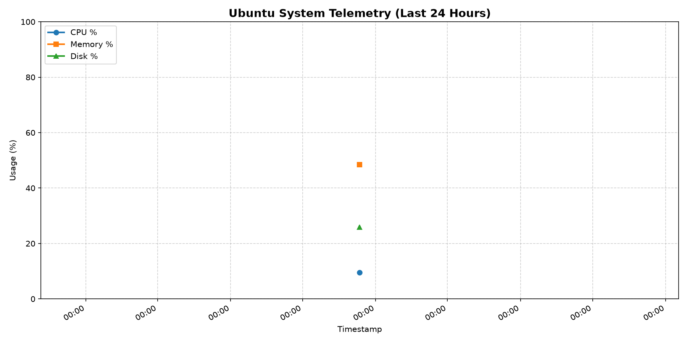

# Ubuntu System Metrics ETL Pipeline

An automated, recurring system telemetry pipeline built on Ubuntu Linux using **Python**, **PostgreSQL**, and **Cron**. It extracts live hardware metrics every 5 minutes, stores time-series data in PostgreSQL, and generates automated 24-hour trend visualizations every 30 minutes.

## Architecture

```text
Ubuntu OS (psutil) ──▶ ingest.py (Cron: */5 min) ──▶ PostgreSQL (server_metrics)
                                                            │
                                                            ▼
charts/system_metrics_latest.png ◀── visualize.py (Cron: */30 min)
```

## Tech Stack
* **OS & Orchestration:** Ubuntu Linux, `cron`
* **Extraction & Load:** Python 3, `psutil`, `psycopg2-binary`
* **Storage:** PostgreSQL (`system_monitor` database)
* **Transformation & Visualization:** `pandas`, `matplotlib` (headless `Agg` backend)

## Sample Output
*Captured during a controlled `stress-ng` CPU and memory load test:*



## Project Structure
```text
system-metrics-pipeline/
├── charts/
│   └── system_metrics_latest.png
├── ingest.py           # Extracts CPU, RAM, Disk, and PIDs into PostgreSQL
├── visualize.py        # Queries last 24h metrics and renders PNG chart
├── requirements.txt    # Isolated venv dependencies
└── .gitignore
```

## Setup & Usage

1. **Clone the repository and install dependencies:**
   ```bash
   git clone [https://github.com/Tejapusarla-13/system-metrics-pipeline.git](https://github.com/Tejapusarla-13/system-metrics-pipeline.git)
   cd system-metrics-pipeline
   python3 -m venv venv
   source venv/bin/activate
   pip install -r requirements.txt
   ```

2. **Initialize PostgreSQL:**
   ```sql
   CREATE DATABASE system_monitor;
   \c system_monitor
   CREATE TABLE server_metrics (
       id SERIAL PRIMARY KEY,
       recorded_at TIMESTAMP DEFAULT CURRENT_TIMESTAMP,
       cpu_percent REAL NOT NULL,
       memory_percent REAL NOT NULL,
       disk_percent REAL NOT NULL,
       active_processes INTEGER NOT NULL
   );
   ```

3. **Configure database credentials:**
   Update `DB_CONFIG` in `ingest.py` and `visualize.py` (or load via environment variables) with your PostgreSQL credentials.

4. **Schedule with Cron (`crontab -e`):**
   ```cron
   */5 * * * * /path/to/venv/bin/python /path/to/ingest.py >> /path/to/logs/ingest.log 2>&1
   */30 * * * * /path/to/venv/bin/python /path/to/visualize.py >> /path/to/logs/visualize.log 2>&1
   ```
